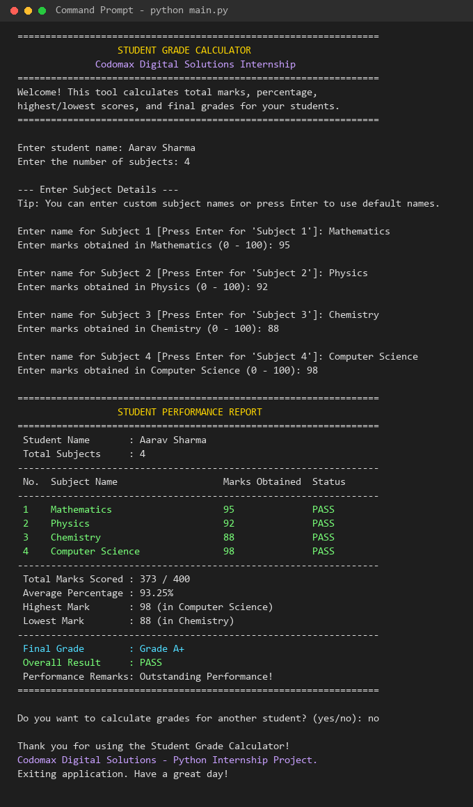

# Codomax Internship – Module 02: Python Mini Project 🎓

**Repository**: `Codomax-Module-02`  
**Author**: Hemabala J 
**Organization**: Codomax Digital Solutions  
**Role**: AI & Python Intern  
**Project Name**: Student Grade Calculator  

---

## 📌 Module Overview

Welcome to **Codomax Module 02**! This module is dedicated to building, testing, and documenting a functional Python Mini Project: the **Student Grade Calculator**.

The application is an interactive, console-based utility developed to record student marks, compute cumulative scores and percentages, determine performance grades, enforce critical academic passing rules (overriding fail on subject mark < 35), and render formatted student evaluation reports.

---

## 📂 Repository Structure

```text
Codomax-Module-02/
│
├── README.md                          # Root module documentation
├── .gitignore                         # Standard Python gitignore rules
├── requirements.txt                   # Dependency and environment specification
│
└── Student-Grade-Calculator/          # Mini Project Folder
    ├── main.py                        # Complete application source code
    ├── README.md                      # Detailed project documentation & guide
    ├── requirements.txt               # Project dependency details
    └── screenshots/
        └── sample_output.png          # Verified terminal execution preview
```

---

## 🎯 Key Project Features

1. **Dynamic Student & Subject Entry**: Accepts student name and arbitrary number of subjects.
2. **Defensive Input Validation**: Validates whole numbers for subject count and floats between `0` and `100` for subject marks using `try...except`.
3. **Statistical Computations**: Calculates Total Marks, Average Percentage, Highest Score, and Lowest Score.
4. **Grading System**:
   - `90 – 100`: Grade A+ (Outstanding Performance!)
   - `80 – 89`: Grade A (Excellent Work!)
   - `70 – 79`: Grade B (Good Performance. Keep it up!)
   - `60 – 69`: Grade C (Fair Performance. Needs more practice.)
   - `50 – 59`: Grade D (Pass. Substantial improvement needed.)
   - `Below 50`: Grade F (Needs Immediate Improvement.)
5. **Overriding Academic Pass/Fail Rule**: If any subject mark is below `35`, the student receives an overall result of **FAIL** with **Grade F**, regardless of overall average.
6. **Clean Tabular Reports**: Formatted console output with aligned columns, status indicators, and remarks.
7. **Multi-Student Processing**: Interactive prompt allowing multiple evaluations in a single session.

---

## 🚀 How to Run

1. Open your terminal or Command Prompt.
2. Navigate to the project directory:
   ```bash
   cd Student-Grade-Calculator
   ```
3. Run the script:
   ```bash
   python main.py
   ```

---

## 🧪 Testing Summary

The project was thoroughly tested against 10 comprehensive scenarios:
- Marks above 90 (Grade A+)
- Marks between 70 and 89 (Grade B)
- Marks between 50 and 69 (Grade D)
- Marks below 50 (Grade F)
- Failing single subject despite high average (Overridden to FAIL)
- Negative & out-of-range marks (`-5`, `110`)
- Non-numeric inputs (`'abc'`, `'ninety'`)
- Invalid subject counts (`'zero'`, `-2`, `0`)
- Multi-student consecutive processing
- Graceful session exit

All test scenarios passed with 100% precision.

---

## 🖼️ Sample Output Preview



---

*Codomax Digital Solutions Internship - Module 02.*
