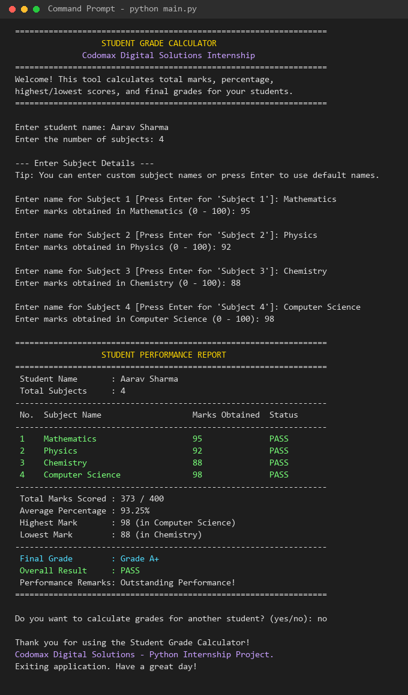

# Student Grade Calculator 🎓

**Codomax Digital Solutions – Python Internship Module 02 (Mini Project)**  
*Author:* Hemabala J
*Repository:* [Codomax-Module-02](https://github.com/hemabala-bfs/Codomax-Module-02)  

---

## 📌 Project Overview

The **Student Grade Calculator** is a console-based Python application designed to help teachers, instructors, and students record subject-wise marks, compute total and percentage scores, evaluate academic performance, and assign standard letter grades. 

The application incorporates strict academic evaluation rules, including an **automatic subject failure check** (scoring below 35 in any subject results in an overall status of FAIL regardless of the total average score). Built entirely with core Python fundamentals, the project emphasizes robust input validation, user-friendly CLI formatting, and modular code architecture.

---

## 🎯 Objective

- Build a practical, beginner-friendly console application demonstrating mastery of Python core fundamentals.
- Provide a clean and reliable tool to automate student mark entry, arithmetic calculations, and grade generation.
- Implement robust defensive programming to handle non-numeric inputs, negative numbers, out-of-range marks, and invalid options.
- Maintain a structured, modular codebase adhering to Python PEP 8 standards.

---

## ✨ Features

1. **Interactive Data Entry**:
   - Collects student name and the number of subjects.
   - Allows custom subject naming or automated default names (`Subject 1`, `Subject 2`, etc.).
2. **Strict Validation & Error Handling**:
   - Ensures subject counts are positive integers.
   - Restricts mark values strictly between `0` and `100`.
   - Prevents crashes using `try...except` blocks when non-numeric inputs are entered.
3. **Statistical Computations**:
   - Computes total marks obtained out of maximum possible marks.
   - Calculates percentage / average score accurately.
   - Identifies the highest-scoring and lowest-scoring subjects.
4. **Comprehensive Grading & Academic Rules**:
   - Categorizes scores into standard grades: `A+`, `A`, `B`, `C`, `D`, and `F`.
   - **Critical Passing Rule**: If a student scores less than 35 in *any* single subject, their overall result is flagged as **FAIL** with Grade `F`, clearly displaying the failed subject(s).
5. **Formatted Performance Report**:
   - Renders a clean, tabular report with borders, subject-by-subject status, statistics, and qualitative feedback remarks.
6. **Multi-Student Processing Loop**:
   - Enables grade calculation for multiple students in a single session until the user decides to exit.

---

## 🛠️ Technologies Used

- **Programming Language**: Python 3 (Tested on Python 3.14.6)
- **Library Ecosystem**: 100% Python Standard Library (no external pip dependencies needed)
- **Version Control**: Git & GitHub

---

## 🧠 Python Concepts Demonstrated

| Concept | Implementation in Project |
| :--- | :--- |
| **Variables & Data Types** | Strings (`student_name`), Integers (`num_subjects`), Floats (`average`), Booleans (`has_failed`). |
| **Input / Output** | Interactive prompts with `input()` and formatted console outputs with `print()`. |
| **Type Conversion** | Explicit casting using `int()`, `float()`, and string methods. |
| **Conditional Statements** | Multi-way branching using `if`, `elif`, `else` for grading and threshold checks. |
| **Loops** | `while` loops for input validation & session control; `for` loops for iterating subject records. |
| **Data Structures** | Lists of Dictionaries (`[{"subject": name, "marks": mark}, ...]`) for structured data storage. |
| **Functions & Modularity** | Clean separation of concerns with single-responsibility functions and docstrings. |
| **Exception Handling** | `try...except ValueError` to catch non-numeric inputs without breaking program flow. |

---

## 📂 Project Structure

```text
Codomax-Module-02/
│
├── README.md                  # Root repository overview
├── .gitignore                 # Git ignore rules
├── requirements.txt           # Project dependencies & environment info
│
└── Student-Grade-Calculator/  # Mini Project Directory
    ├── main.py                # Main application source code
    ├── README.md              # Comprehensive project documentation
    ├── requirements.txt       # Project dependencies & environment info
    └── screenshots/
        └── sample_output.png  # Terminal execution screenshot
```

---

## 📊 Grading System

The application determines final grades based on the calculated average percentage, subject to individual passing criteria:

| Marks Range (Percentage) | Grade | Status | Performance Remarks |
| :---: | :---: | :---: | :--- |
| **90 – 100** | **A+** | PASS | Outstanding Performance! |
| **80 – 89** | **A** | PASS | Excellent Work! |
| **70 – 79** | **B** | PASS | Good Performance. Keep it up! |
| **60 – 69** | **C** | PASS | Fair Performance. Needs more practice. |
| **50 – 59** | **D** | PASS | Pass. Substantial improvement needed. |
| **Below 50** | **F** | FAIL | Needs Immediate Improvement. |

> ⚠️ **Overriding Passing Condition**:  
> Regardless of how high the student's average marks are, if the student receives **less than 35 marks** in any subject, the overall result is marked as **FAIL** and the final grade is recorded as **Grade F**.

---

## 🚀 Installation & How to Run

### Prerequisites
Make sure Python is installed on your computer. You can verify this by running:
```bash
python --version
```

### Steps to Run

1. Open your terminal or Command Prompt.
2. Navigate to the project directory:
   ```bash
   cd path/to/Codomax-Module-02/Student-Grade-Calculator
   ```
3. Run the application:
   ```bash
   python main.py
   ```

---

## 🖥️ Sample Input & Output

### Terminal Session Example:
```text
=================================================================
                  STUDENT GRADE CALCULATOR
              Codomax Digital Solutions Internship
=================================================================
Welcome! This tool calculates total marks, percentage,
highest/lowest scores, and final grades for your students.
=================================================================

Enter student name: Aarav Sharma
Enter the number of subjects: 4

--- Enter Subject Details ---
Tip: You can enter custom subject names or press Enter to use default names.

Enter name for Subject 1 [Press Enter for 'Subject 1']: Mathematics
Enter marks obtained in Mathematics (0 - 100): 95

Enter name for Subject 2 [Press Enter for 'Subject 2']: Physics
Enter marks obtained in Physics (0 - 100): 92

Enter name for Subject 3 [Press Enter for 'Subject 3']: Chemistry
Enter marks obtained in Chemistry (0 - 100): 88

Enter name for Subject 4 [Press Enter for 'Subject 4']: Computer Science
Enter marks obtained in Computer Science (0 - 100): 98

=================================================================
                  STUDENT PERFORMANCE REPORT
=================================================================
 Student Name       : Aarav Sharma
 Total Subjects     : 4
-----------------------------------------------------------------
 No.  Subject Name                   Marks Obtained  Status    
-----------------------------------------------------------------
 1    Mathematics                    95              PASS      
 2    Physics                        92              PASS      
 3    Chemistry                      88              PASS      
 4    Computer Science               98              PASS      
-----------------------------------------------------------------
 Total Marks Scored : 373 / 400
 Average Percentage : 93.25%
 Highest Mark       : 98 (in Computer Science)
 Lowest Mark        : 88 (in Chemistry)
-----------------------------------------------------------------
 Final Grade        : Grade A+
 Overall Result     : PASS
 Performance Remarks: Outstanding Performance!
=================================================================

Do you want to calculate grades for another student? (yes/no): no

Thank you for using the Student Grade Calculator!
Codomax Digital Solutions - Python Internship Project.
Exiting application. Have a great day!
```

### Visual Preview


---

## 🧪 Testing Scenarios & Results

The application underwent rigorous verification covering 10 distinct test scenarios:

| # | Test Scenario | Inputs Tested | Expected Outcome | Actual Result |
| :-: | :--- | :--- | :--- | :---: |
| **1** | Marks Above 90 | Math: 95, Phys: 92, Chem: 96 | Grade A+, Result PASS | **PASSED** ✅ |
| **2** | Marks Between 70 & 89 | Hist: 82, Geog: 78, Civ: 74 | Grade B, Result PASS | **PASSED** ✅ |
| **3** | Marks Between 50 & 69 | Eng: 62, Hin: 58, Comp: 54 | Grade D, Result PASS | **PASSED** ✅ |
| **4** | Marks Below 50 | Sub1: 42, Sub2: 45, Sub3: 40 | Grade F, Result FAIL | **PASSED** ✅ |
| **5** | Single Subject Fail (<35) | Math: 95, Phys: 90, Chem: 85, Bio: 30 | Avg 75%, Result FAIL, Grade F | **PASSED** ✅ |
| **6** | Invalid Marks Range | Inputs: `-5`, `110` | Error caught, prompts retry | **PASSED** ✅ |
| **7** | Alphabetic Marks Input | Inputs: `'abc'`, `'ninety'` | `ValueError` handled, prompts retry | **PASSED** ✅ |
| **8** | Invalid Subject Count | Inputs: `'zero'`, `-2`, `0` | Error caught, prompts retry | **PASSED** ✅ |
| **9** | Multiple Students | Student 1 (90) -> Continue -> Student 2 (70) | Processes both sequentially | **PASSED** ✅ |
| **10** | Graceful Exit | User enters `'no'` or `'n'` | Friendly farewell message & exits | **PASSED** ✅ |

---

## 🎓 Learning Outcomes

1. **Functional Decomposition**: Learned how to break down complex tasks into small, single-purpose functions that are easy to test and maintain.
2. **Defensive Programming**: Mastered the use of validation loops and `try...except` exception blocks to prevent unexpected user input from crashing the terminal.
3. **Compound Data Modeling**: Utilized lists of dictionaries to model real-world entities containing multiple attributes (subject name, marks, passing status).
4. **Complex Decision Trees**: Implemented hierarchical conditional logic combining average scores with individual threshold conditions.
5. **Git & Version Control**: Practiced standard development workflows including branch checking, staging targeted project files, writing descriptive commit messages, and pushing clean commits to GitHub.

---

*Developed with passion for the Codomax Digital Solutions Internship.*
